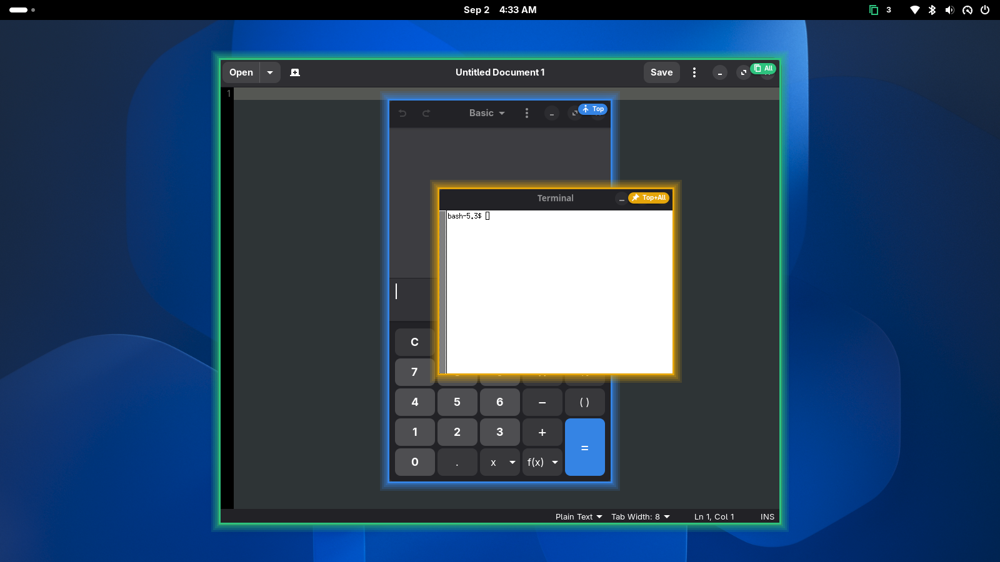
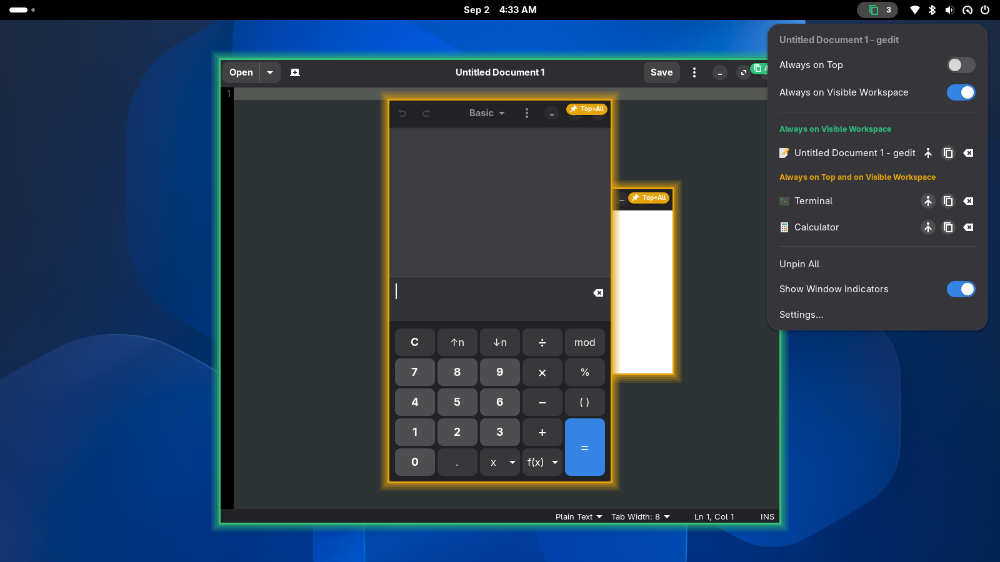
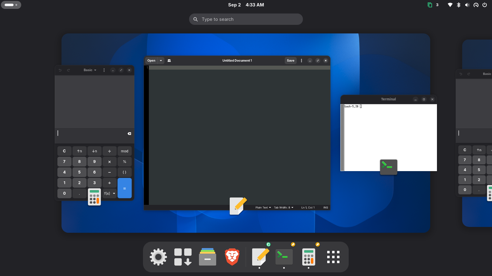
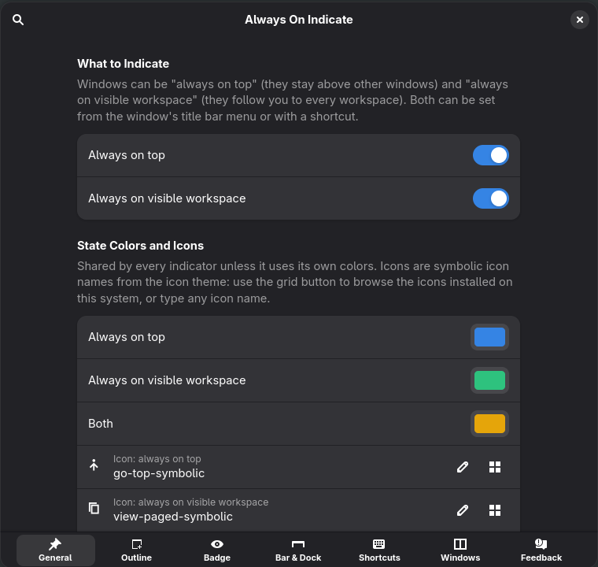

# Always On Indicate

<div align="center">

<a href="https://ko-fi.com/bkrbnkr"></a>

</div>

A GNOME Shell extension that shows you which windows are **always on top**
or **always on the visible workspace**, and gives you every way you might
want to manage them.

GNOME can pin a window above the others or make it follow you across
workspaces, but once you have done it there is nothing on screen to remind
you. Always On Indicate marks those windows wherever you look: on the window
itself, in the top bar, and on the dock. It also brings all the controls
together: GNOME's own shortcuts, extra shortcuts of its own, a top bar menu,
a badge menu, per-app rules and a D-Bus interface for scripting.



| Top bar menu | Overview dash badges |
|---|---|
|  |  |

## Features

- **Window outline** hugging the frame, in a color per state. Width,
  position (inside, outside or centered), opacity when focused and
  unfocused, individual edges, glow and a tint are all adjustable. Corner
  radii follow the window's decorations automatically.
- **Corner badge**: a dot, a state icon, an icon with a text label, or text
  only. Any of eight anchors, offsets, shape, size, colors, border, shadow.
  Click it for a small menu with both toggles, or make it unpin or toggle a
  state. It can also be click-through so it never steals a click from the
  window, fade while the pointer is over it, or **dodge the pointer**: it
  keeps its distance when the pointer comes close, leans into the move, and
  sneaks back to its corner once the pointer has left (distance, how far it
  may leave the window, speed, easing and return delay are adjustable).
- **Top bar indicator** with a count of pinned windows, colored by the
  focused window's state. Its menu has toggles for the focused window, every
  pinned window grouped by state with per-window toggles, "Unpin All" and a
  switch to hide the indicators. Middle click toggles the focused window,
  scrolling cycles through pinned windows.
- **Dash and dock badges** on the app icons in the overview dash and in
  Dash to Dock, as a state icon, a dot or a count.
- **State colors and icons** shared by all of the above. Icons are picked
  from a searchable grid of every symbolic icon installed on the system, or
  typed in by name. Unknown names are flagged in the preferences.
- **Shortcuts**
  - GNOME's built-in window shortcuts (`toggle-above`,
    `toggle-on-all-workspaces`, `always-on-top`) are shown and editable in
    place. They work with or without the extension.
  - Custom shortcuts already on the system (Settings, Keyboard, Custom
    Shortcuts) and shortcuts of other installed extensions that look related
    are found and can be edited too.
  - The extension adds its own, unbound by default: toggle either state, pin
    or unpin both, unpin all, cycle pinned windows, open the menu, hide the
    indicators. Conflicts with any of the above are pointed out while
    recording a shortcut.
- **App rules** by window class, app id or title (contains, exact or regex):
  pin a window automatically when it opens, hide indicators for an app, set
  a window's opacity, and override the outline radius, inset and badge
  position for apps with unusual decorations. Pick a rule target from the
  list of open windows.
- **Decoration profiles**: windows are sorted into server-side decorated,
  client-side decorated, X11 with either, and undecorated. Each profile has
  its own corner radii, outline inset and badge nudge, so a libadwaita app, a
  GTK3 app under XWayland, an Electron app with a custom title bar and a
  borderless game all get an outline that fits.
- **Window behavior**: opacity for always-on-top windows when focused and
  unfocused, raise on pin, restore pinned windows after a shell restart.
- **Feedback**: an on-screen display or notification when a state changes
  (optionally only for changes made through the extension), a pulse of the
  indicators, and a configurable fade with 14 easing curves.
- **Visibility**: show indicators on every pinned window, only the focused
  one, only unfocused ones, or the window under the pointer. Hide them in
  the overview, on fullscreen or maximized windows, or all at once with a
  shortcut.
- **Two drawing layers**: attached to the window (follows minimize,
  workspace switch and overview animations, inherits the window's opacity)
  or on a separate layer directly above it.
- **D-Bus interface** at `org.gnome.Shell.Extensions.AlwaysOnIndicate` for
  scripts, macro pads and custom shortcuts. The Shortcuts page has
  ready-made `gdbus` commands to copy.

## Preferences



The About page links to this repository, the issue tracker, my other
extension [Topbar Tweaks](https://github.com/BeekrBonkr/TopbarTweaks), my
GitHub profile and Ko-fi.

## Requirements

GNOME Shell 48-51 (developed on GNOME 50, tested on GNOME 50 and 51).

## Install

1. Build the schema and copy the files into place:

   ```bash
   make install
   ```

2. Log out and back in (required on Wayland).
3. Enable the extension:

   ```bash
   gnome-extensions enable always-on-indicate@beekrbonkr.github.io
   ```

Open the settings with:

```bash
gnome-extensions prefs always-on-indicate@beekrbonkr.github.io
```

## Scripting

Window id `0` means the focused window. Other ids come from `ListWindows`.

```bash
gdbus call --session --dest org.gnome.Shell \
  --object-path /org/gnome/Shell/Extensions/AlwaysOnIndicate \
  --method org.gnome.Shell.Extensions.AlwaysOnIndicate.ToggleAbove 0
```

| Method | What it does |
|---|---|
| `ListWindows` | Returns every tracked window as JSON (id, title, class, app id, states, workspace, monitor, decoration profile, frame) |
| `ToggleAbove id` | Toggles always on top |
| `ToggleSticky id` | Toggles always on visible workspace |
| `TogglePin id` | Sets both states, or clears both if either is set |
| `SetState id above sticky` | Sets both states explicitly |
| `UnpinAll` | Clears both states on every window |
| `CyclePinned` | Activates the next pinned window |
| `ToggleIndicators` | Hides or shows all window indicators |

A `StateChanged (id, above, sticky)` signal is emitted on every change.

## Notes on other extensions

- Dock badges appear in the overview dash and in Dash to Dock (and forks
  that reuse the shell's dash). Other docks and panels are not badged.
- The "attached" drawing layer shows the outline in overview window
  previews when "Hide in the overview" is off. Outside outlines are clipped
  to the window there.

## Testing in a nested shell

```bash
make test
```

runs a nested GNOME Shell with a virtual monitor. On Fedora-based systems it
needs the `mutter-devkit` package for a visible window; without it the shell
runs headless.

```bash
make test-headless            # or: tests/nested-test.sh <id> [basic|stage|pill|opacity|readme|dodge]
```

runs an automated headless session with an isolated settings database. It
opens a few windows, pins them over D-Bus, checks the overlays, the top bar
menu, the badge menu and the dock badges, walks every page of the
preferences window and saves screenshots under `$TMPDIR/aoi-test/`. The live
session is not touched. The `dodge` scenario additionally drives a virtual
pointer at a badge to exercise dodging, hover fade and click-through.

---

## Support

<div align="center">

This extension is free and open source, and I work on it in my spare time.<br>
If it saved you some time, you can buy me a coffee. No pressure - the code stays free either way.

<a href="https://ko-fi.com/bkrbnkr"></a>

</div>

<!-- more ways to support go here -->
<!-- - [PayPal](...) -->
<!-- - [GitHub Sponsors](...) -->

## License

GPL-3.0-or-later, see [LICENSE](LICENSE).
